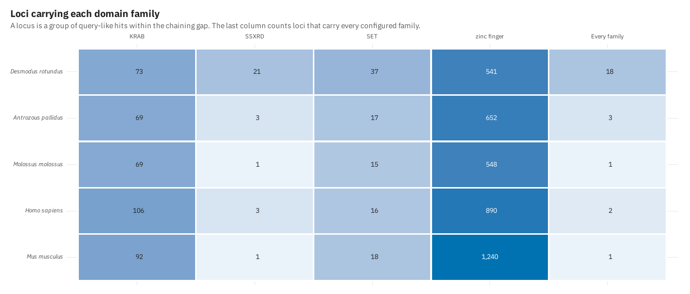
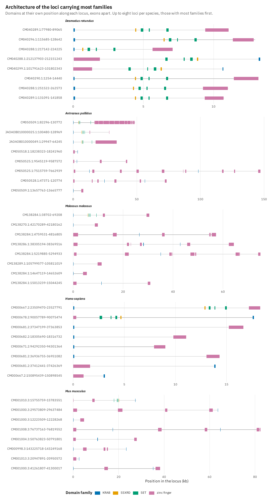
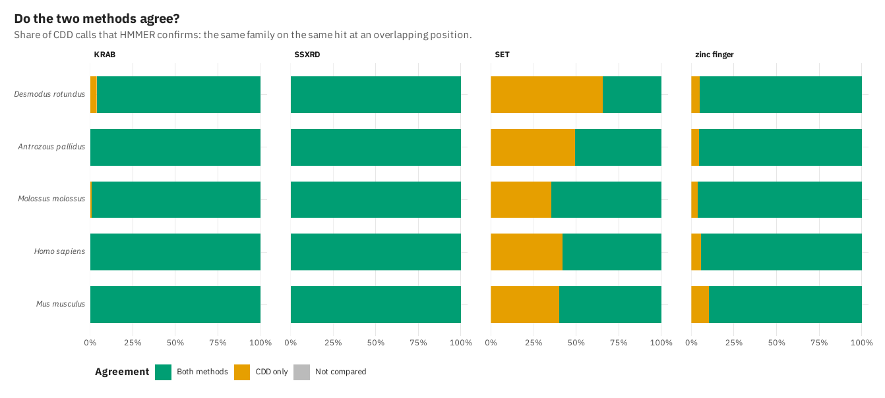

[](https://github.com/JorgeAndOmics?tab=repositories)
[](https://www.linkedin.com/in/jorge-gonzalez-garcia/)


[](images/logo.png)


# rpsHunter


**rpsHunter** finds the regions of genomes that resemble your query proteins and describes the protein domains inside them. It searches with tBLASTn, calls domains in every hit with RPS-BLAST against NCBI CDD and, independently, with HMMER against Pfam, puts the exons of a gene back together into loci, and reports each domain at its own genomic position.

Built on Snakemake, it runs in parallel, reruns only what a changed setting affects, and records what every run was made with.

## Key Features

- **Finds query-like regions and describes their domains**: tBLASTn with your proteins, then domain
  searches of every hit that passes a quality gate
- **Two independent domain searches**: NCBI CDD models (RPS-BLAST) and Pfam profiles (HMMER), with
  agreement reported only where their positions overlap
- **Families defined by accession** in the config, so any protein family can be studied
- **E-values on NCBI's scale** although only the families' models are searched, with an evidence tier
  on every call
- **Each domain at its own genomic position**, as tables and as GFF3 tracks
- **Loci**: exons chained into gene-sized regions, with the coverage of each family's model added up
  across exons
- **Reproducible**: locked environment, genomes pinned by assembly, identical tables on rerun
- **Audit trail**: every hit keeps the gate's verdict; every job keeps a log and a benchmark
- **Linux** (including Windows through WSL); the shell steps rely on GNU tools

## Quick Start

```bash
git clone https://github.com/JorgeAndOmics/rpsHunter.git
cd rpsHunter
make env                      # the locked conda environment `rpsHunter`
conda activate rpsHunter

# Edit data/config/config.yaml: queries, species, domain families, folders.

./rpsHunter --download-databases --download-genomes --download-queries   # once
./rpsHunter --all -n          # list what the analysis would run
./rpsHunter --all             # search, domains, loci, figures
```

Results are tables under `results/tables/`, GFF3 tracks under `results/ranges/` and figures under
`results/plots/`; see
[Outputs](docs/outputs.md). The shipped config finds PRDM9-like regions in five mammalian genomes.

## Installation

Linux (including Windows through WSL). Needs [conda](https://docs.conda.io); everything else,
including BLAST+, HMMER, rpsbproc and Snakemake, comes with the environment.

```bash
make env        # creates the environment from data/config/environment.lock-linux-64.txt
```

The databases (`--download-databases`) are NCBI CDD with its annotation files and Pfam: about 8 GB
to download and 45 GB unpacked, under `root.db_root_folder`.

## Usage

```bash
./rpsHunter --help                     # stages, grouped, with examples
./rpsHunter --all                      # everything after the downloads
./rpsHunter --domains --loci           # only these stages (and what they need)
./rpsHunter --all --config my.yaml     # another config file
```

Before anything runs, rpsHunter checks the config, the tools and the input files, offline and
without questions, and lists what Snakemake would do. A stage builds what it needs upstream, but a
download, a BLAST database build or a tBLASTn search starts only when its own stage is requested;
otherwise the run stops and says why. After a config change, the next run redoes exactly the steps
that change affects. See the [CLI Reference](docs/cli-reference.md).

## Documentation

| Document | Description |
|----------|-------------|
| [Architecture](docs/architecture.md) | Data flow, modules, contracts, reproducibility, tests |
| [Configuration](docs/configuration.md) | Complete `config.yaml` parameter reference with types, defaults, and examples |
| [Filtering](docs/filtering.md) | What is searched, kept and reported at each step, and what cannot be concluded |
| [Outputs](docs/outputs.md) | Output directory structure, parquet column schemas, file format descriptions |
| [CLI Reference](docs/cli-reference.md) | Stages and options, the checks and the guard, exit statuses, what reruns when |
| [Visual style](docs/visual_style.md) | The colour, type and layout system of the figures |
| [Console and logs](docs/console_style.md) | What a run prints, where every line is kept, verbosity and colour |
| [Troubleshooting](docs/troubleshooting.md) | Common problems and what to do about them |

## What the figures look like

From the shipped example (three PRDM9 queries on five mammalian genomes).

Loci carrying each domain family:

[](images/loci-by-family.png)

The loci carrying most families, domain by domain (human PRDM9 and PRDM7 are the first two
*Homo sapiens* rows):

[](images/locus-architecture.png)

Whether the two methods agree:

[](images/method-agreement.png)

## Environment Variables

| Variable | Use |
|---|---|
| `RPSHUNTER_CONFIG` | Config file for the run, when `--config` is not given |
| `NCBI_API_KEY` | Optional. Raises NCBI's request limit for `--download-genomes` and `--download-queries`. Never put the key in the config |

`execution.entrez_email` in the config is sent to NCBI when query proteins are downloaded, as its usage policy asks.

## Acknowledgments

[](images/TCD.png)

- Ni Leathlobhair lab @ Moyne

## Contributing

Contributions are always welcome! Feel free to generate a pull request, or contact me at jgonzlez@tcd.ie for any questions.

## License

[MIT](LICENSE). To cite rpsHunter, see [CITATION.cff](CITATION.cff).

## References

Camacho, C., Coulouris, G., Avagyan, V., Ma, N., Papadopoulos, J., Bealer, K., & Madden, T. L. (2009). BLAST+: Architecture and applications. *BMC Bioinformatics, 10*, 421. https://doi.org/10.1186/1471-2105-10-421

Sayers, E. W., Bolton, E. E., Brister, J. R., Canese, K., Chan, J., Comeau, D. C., ... & Ostell, J. (2022). Database resources of the National Center for Biotechnology Information. *Nucleic Acids Research, 50*(D1), D20-D26. https://doi.org/10.1093/nar/gkab1112
(*Reference for NCBI Datasets and API services*)

Eddy, S. R. (2011). Accelerated profile HMM searches. *PLoS Computational Biology, 7*(10), e1002195. https://doi.org/10.1371/journal.pcbi.1002195
(*Reference for HMMER*)

Mistry, J., Chuguransky, S., Williams, L., Qureshi, M., Salazar, G. A., Sonnhammer, E. L., ... & Bateman, A. (2021). Pfam: The protein families database in 2021. *Nucleic Acids Research, 49*(D1), D412-D419. https://doi.org/10.1093/nar/gkaa913
(*Reference for the Pfam database*)

Molder, F., Jablonski, K. P., Letcher, B., Hall, M. B., Tomkins-Tinch, C. H., Sochat, V., ... & Koster, J. (2021). Sustainable data analysis with Snakemake. *F1000Research, 10*, 33. https://doi.org/10.12688/f1000research.29032.2
(*Reference for the Snakemake workflow management system*)
